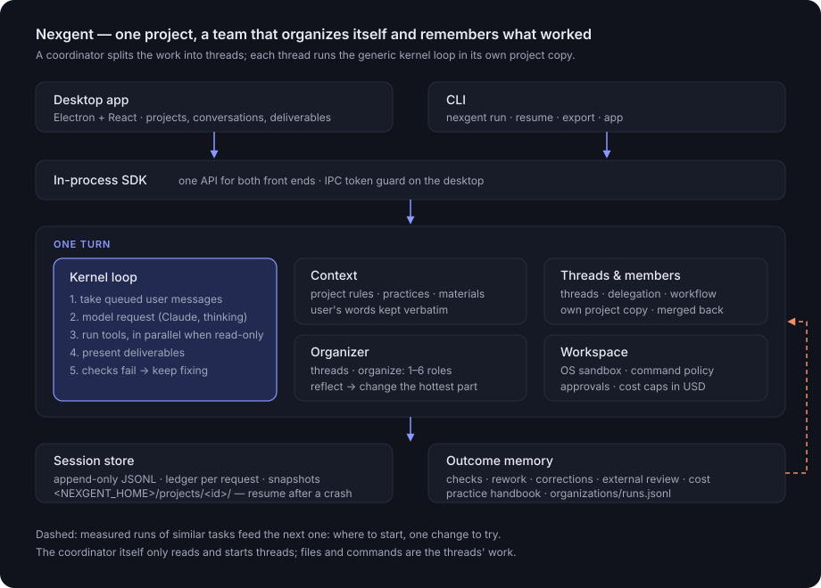

# Nexgent 产品与设计定位

> 状态：现行设计
>
> 适用范围：产品行为、内核之上的各层、桌面应用与命令行
>
> 文件格式与权限见 [`spec/`](spec/)

## 1. 一句话定位

**Nexgent 是一个在你的项目文件夹里干活的通用智能体应用：每个项目有一个协调者，把活拆给讨论串去做；讨论串之间怎么配合，由宿主按记录下来的协作问题一次试一处、留下有用的。**

> **One project. A team that learns.**

## 2. 系统形态

桌面应用与命令行共用一个进程内 SDK。每个项目有一个常驻的总对话（协调者）；它把每一块活交给一个讨论串，讨论串是普通对话，在后台、在自己的项目副本里干活，需要时在内部派成员。每一轮都在同一个内核循环里走完；会话记录让一切可恢复；组织库和经验手册把同类任务上有效的做法带到下一次。

## 3. 想做成什么

1. **日常任务好用。** 在真实的项目文件夹里干活，多轮对话，能停、能撤回、能恢复，成果有版本。
2. **自己组织怎么做。** 协调者只拆分、派活、跟进、转达你的纠正、汇总；讨论串按自己那一块的大小决定自己做还是组队。
3. **在做事的过程中改进。** 宿主在项目里攒下项目记忆，把反复出现的偏离、热点和拆分问题带着证据告诉你，由你决定记不记（第 8、9 节）。讨论串之间的协作方式也在改进：宿主从运行记录里数出讨论串之间的协作问题（改了同一批文件、合并冲突、交接漏了文件、改了分给别人的文件），一次只试一个协作变量，由宿主强制执行，按同样的问题有没有再出现判断留还是退。你看到的只是一行“这次试了什么协作方式”，没有改进设置。
4. **不为某个任务特化。** 产品代码、系统提示和判定规则里不写只对某类任务成立的东西。案例只用来测量。

技术选型：TypeScript，Electron 桌面应用加命令行，不做 Web 服务；运行架构用 npm 上的 Cordis；DeepSeek Harness 只作只读参考，以子模块固定在 `reference/deepseek-harness`，不参与构建，改写的文件加来源头注并登记在 `THIRD_PARTY_NOTICES.md`；模型走 Claude Platform，默认 `claude-sonnet-5-5`、开 thinking，不做多 provider 抽象。

## 4. 一个任务怎么走

1. 你在总对话里说要做什么，也可以用输入框旁的“指定讨论串”（命令行用 `--thread`）写明要开哪几个讨论串（标题和各自一句话）。协调者看到项目规则、项目笔记、你点名的讨论串和这次的协作方式。
2. 协调者把活拆成几块，每块交给一个讨论串，写清目标、输入、完成标准、不许碰的东西和它改哪些路径（`owns`）。你点名了讨论串时，协调者只能开这几个、标题照你的，不能增减；这份点名存在项目里，重启后照样约束。你在总对话里说的话（包括中途插话）由宿主原样转给相关的讨论串，不靠协调者转述，压缩时也逐字保留。小任务整件交给一个讨论串。几个讨论串可以同时跑，超过上限的排队，有一个结束就补上。
3. 讨论串在自己的项目副本里做。小的一块（几个文件、一处连在一起的改动，自己跑测试就能查）自己做、自己查；大的用 `organize` 派成员。
4. 讨论串做完一轮，改动合回项目，并叫醒协调者。协调者先给你几行汇总，再决定下一步：回答它、派下一块、停掉某个讨论串（`stop_thread`），或收尾。两个以上讨论串合入了文件、都结束之后，宿主自己开一轮检查整个项目（跑项目自己的测试和构建，修掉合并弄坏的）。
5. 你随时可以插话。你的原话转给相关的讨论串；你也可以直接进讨论串里说（不占同时运行的名额），在侧栏“新建讨论串”自己开一个。每个对话（包括每个讨论串）都有停止按钮；停一个讨论串会连同它派的成员一起停，停止写进协作记录，协调者看得到。你开的讨论串做完一轮也会叫醒协调者，由它跟进。程序退出时被打断的、协调者派的讨论串，下次打开项目时接着做。
6. 任务的讨论串都结束后，宿主数这次的协作问题，记进组织库，并判断正在试的协作变量（第 7 节）。

不想要协调者时，可以开普通对话：普通对话自己读写文件、跑命令，也能组队。命令行用的就是普通对话。

会话记录是只追加的 JSONL，每次模型请求在账本里记一条，所以进程被强杀后可以恢复，花费也查得清楚。

## 5. 任务内：一纠正就调整，记得前面的事

- **运行中插话。** 输入框不锁，消息在下一次模型请求前插入；正在跑的成员也收到，排在后面才开始的成员开头也会收到。
- **原话不丢。** 上下文压缩时，摘要后面逐字附上你说过的所有原话，最多 6 万字符，超出时保留最新的。压缩记录记下保留了哪几句（`userWords`），界面在分隔线上写明句数，并给这些气泡标“你说过 · 逐字保留”。
- **自己检查。** 交付后跑测试、你设的检查命令、检查交付的文件能不能打开；没过就在同一轮里接着改，默认最多 2 次。
- **断了重发。** 回复传到一半连接断了，丢掉半截重发这一步，最多 2 次。出错结束的讨论串或成员不把半成品合回项目。

## 6. 两层组织

- **协调者层。** 协调者没有写文件、跑命令和派成员的工具，只有只读工具、讨论串工具（`start_thread`、`message_thread`、`read_thread`、`list_threads`、`stop_thread`）、协作记录（`read_collab`，`post_collab` 只写说明）和项目笔记。它的组织就是怎么拆：拆成几个讨论串、哪块给谁、谁等谁。`read_thread` 可以看讨论串最后一轮每一步做了什么。同时默认最多 3 个讨论串在跑（项目设置里可改为 1 到 8），一个对话最多 12 个。
- **协作记录放在项目里。** 每个总对话在项目的 `.nexgent/collab/` 下有一份只追加的协作记录（自带 `.gitignore`，不进 git；几个进程同时写时加锁，太长时把以前任务的条目归档）。讨论串的每一轮把文件合回项目时，宿主写一条“合入了哪些文件、各加减几行”，讨论串可以用 `read_merged` 看合并后的版本；一轮结束时它的认领随之释放。协调者可以写给所有讨论串的说明；讨论串可以不结束这一轮就问协调者（`ask_coordinator`，每轮最多 3 次）。宿主在讨论串**每次模型请求之前**把它还没看过的相关条目插进去，所以一个一直在跑的讨论串也收得到；跑得久的命令 20 秒后转到后台，不挡住送达。每次最多整条送 12 条、约 4000 字，其余只给条数。每个讨论串看到哪一条记在记录旁边，重启不丢，不重复送。历史被压缩后，仍然有效的条目再送一次。
- **讨论串之间说的话你都看得到。** 讨论串写进协作记录的每一条（留言、说明、交接、阻塞、认领、停止）在下一次请求前送到协调者，也显示在总对话和相关讨论串的窗口里，合入与停止同样显示。没有你看不到的往来。
- **讨论串之间怎么配合。** 讨论串总能给另一个讨论串留言（`message_peer`）、问协调者、翻看协作记录（`read_collab`）和看合并后的文件。默认是集中分派：分工由协调者定。在设置里把“讨论串协作”改成“互相配合”后，讨论串还能往协作记录里写（`post_collab`：说明、对路径的认领、交接、阻塞，阻塞可以写明在等谁）。送达时按相关性分：给它的留言、说明、阻塞，以及路径和它要改或已读写的路径重叠的认领、交接、合入，整条给；其余只给一行条数。宿主拒绝几种情况：认领的路径和本任务一个还在干活的讨论串重叠；一个讨论串一个任务里给同一个讨论串留超过 6 条；回复的回复再转下去（最多转 2 次）；写明在等的对方也在等它（互等）。这个选择只由你在设置里改，宿主不会自己切换。
- **讨论串层。** 讨论串需要组队时用一个 `organize` 工具一次给出分工：1–6 个角色，只有通用的五种（规划、调查、实现、测试、审查），写明谁等谁。成员在讨论串副本的副本里干活，合回讨论串，讨论串这一轮结束再合回项目。分工没有进展或检查没过时换分工，并写明原因。
- **要不要组队由宿主先定。** 很小的任务（一行、40 个字或词以内、没有资料）单独做；其余按组织库的建议，并始终留一部分单独做作对照。讨论串拿到组队的建议后，仍按自己那一块的大小判断是否真的派成员。
- **合回后整体检查。** 每个讨论串只查了自己的副本，几个讨论串都合回之后，宿主让最后合入的讨论串检查整个项目（试验值是另开一个没参与的讨论串检查）。讨论串的副本开不出来、直接改项目时，界面上会标出来。

## 7. 协作问题与协作试验

- **数协作问题，不数份额。** 一个任务的讨论串都结束后，宿主从运行记录里数出讨论串之间的协作问题：两个讨论串改了同一个文件（`overlap`）、合并冲突（`conflicts`）、一个讨论串去读另一个讨论串写的文件却没找到，说明交接漏了（`missing`）、改了 `owns` 以外的文件（`outside`）、讨论串之间的消息数（`messages`）、宿主拒绝的认领和留言（`refused`）。另外还数：同一个讨论串反复读同一个文件（`reread`，交接没说清）、留言没人回（`unanswered`）、因为等别人而停下（`idle`）、被上限或互等拒绝（`capped`、`cycles`）、讨论串内部换分工（`regroups`）、整体检查没过（`checkFailed`）。“同一个文件”只算同时在跑的两个讨论串，先后做的不算。这些数记在组织画像的 `events` 里，非零的也出现在叫醒协调者的那条提示里。
- **只看真正分给了两个以上讨论串、你没有点名分工、结果能判断的任务。** 只有一个讨论串时没有协作可言；你点名的分工照你的来，不拿来试；讨论串报告格式不对、看不出做没做完的也不计入。任务按形状分开比较：普通还是互相配合、2 个还是 3 个以上讨论串、改动路径分开、重叠还是没写。
- **协作变量由宿主执行。** 现在有四个变量：`overlap`（默认 `parallel`；试验值 `sequence`：改动路径重叠的讨论串一个跑完另一个才开，没写 `owns` 的不和别的同时跑，等的进队列）、`handoff`（默认 `brief`；试验值 `changed`：这次任务每个讨论串合入了哪些文件，一写进协作记录就送到这次任务的每个讨论串）、`wake`（默认 `coordinator`：只有协调者能叫醒空闲的讨论串；试验值 `named`：给空闲讨论串的留言会开它的下一轮，每任务最多 4 次）和 `check`（默认 `merged`；试验值 `separate`：另开一个讨论串做最后的整体检查）。它们不是写给模型的建议，宿主直接执行；一个任务里试验值真的起了作用（排了队、送了合入、叫醒了、开了检查）才算试过。
- **一次只试一个。** 最近一个计入的任务出现了某个变量要消除的问题、这个变量还是默认值、也不在冷却期时，开始试它；几个都可以试时，选基线里目标问题出现得最多的那个，并记下原因。基线取最近最多 10 个计入的任务（至少 3 个），其中出现目标问题的比例为 p。需要连续 n 次干净：n 取 2 到 4 中最小的、使 (1−p)ⁿ ≤ 0.1 的数，也就是说光靠运气连续这么多次都没出问题的概率不超过 1 成；问题太少、4 次也判断不了时不试。
- **留还是退。** 在试验值真的起了作用的任务里：目标问题又出现、结果没做好（你对某个讨论串的纠正算没做好，对协调者说的不算）、花费超过基线中位数的 1.5 倍、或用时超过 2 倍，就退回；连续 n 次干净就留下，以后默认这样；6 个任务还没有结论就作罢。退回或作罢的变量在之后 10 个计入的任务里不再试。
- **哪种分工更顺利。** 讨论串内部组队与否仍按组织库：任务按文字相似归类，同一类里组队和单独做各满 5 次后，一边明显更好才下结论；对照比例没结论时 1/5，有结论后 1/10。“顺利”指正常完成、检查没失败、没被纠正、之后没返工，请了外部评审的还要评分不低于 0.7。
- **你看到什么。** 总对话这一轮下面一行小字：“这次试一种协作方式：……”，或“以后都这样协作：……”“试过没变好，已改回：……”“没试出结果，先不这样：……”。项目记忆页上每类任务一句话：哪种分工更顺利、花费多多少。没有开关。

以前的做法是在下一次同类任务的提示里加一句改法、按花费份额判断，实测 11 条改法没有一条留下，已经停用；旧记录里的改法行仍按原样显示。

## 8. 项目记忆

侧栏的“项目记忆”页：项目规则、经验和项目笔记放在一处，每条写明来源（你加的、你说的原话、从哪个任务学到）和时间，可以改、删、手动添加。删掉的收在折叠的“已删除”里，能恢复，历史不丢。

- **项目规则。** 你亲口说成长期约定的话（“一律”“以后都”）记成项目规则，保留你给的具体数值和范围；只针对这一次的不记。每次任务都给出全部规则，规则压过项目里旧文档的说法，只有本次任务消息里明确的要求能压过规则。规则与现有测试或代码冲突时先问你以哪个为准。
- **纠正时当场问要不要记住。** 你纠正做法、或说以后这个项目都该怎样时，总对话或讨论串用 `propose_memory` 提一条规则：一句话，加上你的原话。宿主核对原话确实出自你在这个对话里的消息，对不上就拒绝。对话里出现一张“要记住吗”卡片，你可以记住、改一下再记、或不用；确认前它不算规则，不给任何任务。
- **项目笔记。** 协调者用 `update_project_notes` 维护一份笔记（长期目标、约定、做过的决定、踩过的坑，一行一件事带原因，最多 8000 字），每轮开头都看到；不记进度和一次性要求。你也可以在项目记忆页直接改。派讨论串时把适用的规则带过去。
- **过时提醒。** 一条记忆可以带它说到的文件。文件已经不在项目里时，页面上标“可能过时”，给模型时也注明，由你决定改还是删。

## 9. 项目观察：反复出现的问题，带证据告诉你

宿主在每个任务结束后，从运行记录里数出这次的事实，追加到项目的 `memory/facts.jsonl`，不问模型：你中途的纠正和返工（任务开头说上次的结果不对）、哪些文件出过麻烦（合并冲突、几个讨论串同时改、改到分配范围以外、同一轮里反复读）、拆分出的问题（最后检查没过、讨论串互相等、留言没人回、没做完）、同样的调用连续失败。然后在最近 12 个任务里找反复出现的模式：

- **指令偏离。** 意思相近的纠正在 2 个以上任务里出现：你在反复说同一件事，还没成为规则。
- **设计热点。** 同一个文件或目录在 3 个以上任务里出麻烦。
- **拆分问题。** 分给多个讨论串的任务里，2 个以上拆分出了问题。
- **卡住。** 同一个工具同样的错误连续 3 次以上，并在 2 个以上任务里出现。同一个任务里一出现就提醒模型换个做法。

每条观察带着证据：哪几个任务、你的原话、涉及的文件、每种问题各几次。任务结束时，总对话的输入框上方出现“项目观察”卡片，一次最多 3 条，可以收起；项目记忆页上也列出。每条只有一个动作和“忽略”：指令偏离记成规则，拆分问题记成“以后这类任务这样拆”，卡住记成经验，设计热点让协调者读代码、给出拆分或调整结构的建议（只提建议，不改动）。记之前可以先改文字。忽略过的不再提。观察本身不改代码、不改规则，一切由你决定。

发现模式时，桌面应用另用一次模型调用给每条写一两句建议和可直接采纳的规则文字；没有新模式时不调用。协调者每轮看到还开着的设计热点和拆分问题，派活时考虑进去。花费和用时只记下、显示，不参与任何判断。

## 10. 经验

- 每个任务结束后，后台给结果打分、总结一条可复用的做法，写进经验手册。下次做类似的事时检索出来给模型。
- 一条经验有没有用，靠随机给与不给的对照判断；结局只认确定性检查、你的明确信号和外部评审的抽查，不认模型给自己打的分。帮上忙够多次才正式启用，带偏了自动停用。
- 学习默认开，每个项目 30 天最多花 3 美元，可以在设置里关掉或改预算。

## 11. 权限与安全

- 文件权限分只读、可写工作区（默认）、完全访问，另有计划模式（先只看不改，批准后才动手）。
- 命令和 `run_code` 在系统沙箱里跑（Linux 用 bubblewrap，macOS 用 seatbelt，Windows 用专用沙箱账户，装一次要管理员确认），只能写项目目录和会话临时目录，读不到用户目录下的其他文件；联网默认按域名白名单，常用包源直接放行，新域名问一次，可以记住。Windows 上沙箱没装时，不是只读的命令逐条问你。
- 读写项目外的路径、写敏感文件、在沙箱外重跑命令要你批准；讨论串里要批准时，总对话的卡片上会提示，点进去批准。
- 费用按美元计，任务、对话、项目三级上限，达到 80% 预警。
- 密钥只从环境变量或本机的 `credentials.json` 读，不写进项目。

细节见 [权限](spec/permissions.md)。

## 12. 还没做到的

- 插话、组队、讨论串、你点名的讨论串、原话转达、排队、协作变量的执行和互相配合模式都有脚本化模型的测试。真实模型只在 macOS 和云端小规模试过：协调者会拆成讨论串、纠正能转到讨论串、跨轮提示缓存能命中；协作试验和互相配合模式还没有在真实任务里跑过。
- 切换“讨论串协作”时，空闲的对话会关掉、下次用时按新方式重开；正在跑的对话要等这一轮结束、重开后才用新方式。
- 讨论串在后台要批准时，批准本身要进那个讨论串做；只有协调者派的讨论串在重启后接着做，你自己开的不会。
- 项目观察有脚本化模型的测试，还没有在真实任务里跑过；它要攒几个任务才会出现，相近的纠正按词语重合判断，说法差得远的不会归到一起。
- 分工比较和协作试验都要攒次数，前期多半没有结论；按文字归类时，说法相近、内容不同的任务会被合在一起。
- 组队和讨论串一般比单独做贵。
- macOS 沙箱没有实测，Windows 沙箱没有在 Windows 上实测，Windows 与 macOS 安装包没有验证。

文件格式见 [数据格式](spec/data-formats.md)，权限见 [权限](spec/permissions.md)。
